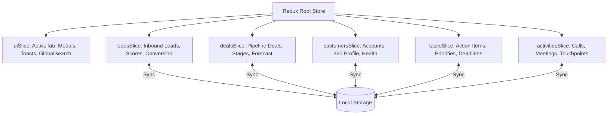

# Vanguard CRM — Enterprise Sales & Customer Operations Platform


[](https://react.dev/)
[](https://www.typescriptlang.org/)
[](https://redux-toolkit.js.org/)
[](https://tailwindcss.com/)
[](https://recharts.org/)
[](https://vite.dev/)
[](LICENSE)

**Vanguard CRM** is a modern, high-performance, and responsive enterprise Customer Relationship Management (CRM) platform. Designed for high-velocity B2B sales teams, revenue leaders, and account executives, it delivers unified lead capture, interactive visual sales pipelines, 360-degree customer relationship management, prioritized task management, touchpoint activity tracking, and executive analytics.

---

## 📑 Table of Contents

- [Key Features](#-key-features)
  - [1. Lead Management & Conversion](#1-lead-management--conversion)
  - [2. Visual Sales Pipeline (Kanban)](#2-visual-sales-pipeline-kanban)
  - [3. Customer Profiles & 360° Account View](#3-customer-profiles--360-account-view)
  - [4. Task Management & Deadlines](#4-task-management--deadlines)
  - [5. Activity Tracking & Touchpoint Audit Trail](#5-activity-tracking--touchpoint-audit-trail)
  - [6. Executive Dashboard & Analytics](#6-executive-dashboard--analytics)
  - [7. Authentication & Access Management](#7-authentication--access-management)
  - [8. Dark Theme & Light Theme Engine](#8-dark-theme--light-theme-engine)
  - [9. Indian Enterprise Ecosystem & INR Currency Engine](#9-indian-enterprise-ecosystem--inr-currency-engine)
- [Technical Architecture](#-technical-architecture)
- [Prerequisites](#-prerequisites)
- [Command Line Reference (CMD)](#-command-line-reference-cmd)
  - [Installation & Setup](#installation--setup)
  - [Development Server](#development-server)
  - [Production Build & Type Check](#production-build--type-check)
  - [Production Preview](#production-preview)
  - [Linting](#linting)
- [Project Directory Structure](#-project-directory-structure)
- [State Management Architecture (Redux Toolkit)](#-state-management-architecture-redux-toolkit)
- [Environment & Deployment](#-environment--deployment)
  - [Deploy to Vercel](#deploy-to-vercel)
  - [Deploy to Netlify](#deploy-to-netlify)
  - [Docker Containerization](#docker-containerization)
- [License](#-license)

---

## 🚀 Key Features

### 1. Lead Management & Conversion
- **Multi-View Catalog**: Toggle seamlessly between high-density **Table View** and visual **Cards Grid View**.
- **Real-Time Stage Qualification**: Track leads through `New`, `Contacted`, `Qualified`, `Proposal`, `Negotiation`, `Converted`, and `Lost` with direct inline dropdown changers.
- **Dynamic Lead Scoring**: 0–100 algorithmic score indicators with visual badges (`High Hot`, `Moderate Warm`, `Needs Qualification`).
- **1-Click Enterprise Lead Conversion**: Converts qualified leads directly into active **Customer Accounts** and opens pipeline **Deals**, preserving notes and automatically recording audit activities.
- **Search, Filter & CSV Export**: Real-time multi-attribute search and 1-click export of leads to `.csv`.

### 2. Visual Sales Pipeline (Kanban)
- **Interactive Kanban Board**: Visual columns for 6 distinct sales stages:
  1. `Discovery`
  2. `Qualification`
  3. `Proposal`
  4. `Negotiation`
  5. `Closed Won`
  6. `Closed Lost`
- **Dynamic Stage Aggregation**: Each column displays deal counts and real-time total pipeline dollar values.
- **Weighted Forecasting**: Computes total pipeline value alongside probability-weighted forecast (`Deal Value × Probability %`).
- **Stage Navigation**: Move deals forward or backward with 1-click directional buttons, or update via modal and inline dropdowns.
- **AE Filters**: Filter the entire pipeline board by specific Account Executives (`Sarah Jenkins`, `Alex Rivera`, `Elena Rostova`, `Marcus Vance`) or view the consolidated team pipeline.

### 3. Customer Profiles & 360° Account View
- **Enterprise Customer Directory**: Manage accounts classified by Tier (`Enterprise`, `Mid-Market`, `Startup`, `SMB`) and Status (`Active`, `Onboarding`, `At Risk`, `Churned`).
- **Account Health Monitoring**: Visual health gauges (0–100%) tracking retention risk with `At Risk` alerts.
- **Slide-Over 360° Profile Drawer**:
  - **Financial Summary**: Tracks Lifetime Value (LTV), Monthly Recurring Revenue (MRR), and Contract Values.
  - **Account Contacts**: Direct email, phone, website, HQ address, and headcount metadata.
  - **Associated Active Deals**: Displays all open pipeline opportunities connected to the account.
  - **Touchpoint History Timeline**: Chronological stream of calls, meetings, emails, and internal risk notes.
  - **Interactive Account Tagging**: Add custom operational tags (e.g., `SOC-2 Certified`, `Annual Prepay`, `Beta Tester`).

### 4. Task Management & Deadlines
- **Action Item Prioritization**: Assign tasks with strict priority levels (`Urgent`, `High`, `Medium`, `Low`).
- **Category Classification**: Filter tasks by `Call`, `Meeting`, `Email`, `Follow-up`, `Review`, and `Contract`.
- **Entity Association**: Cross-link tasks directly to specific Leads, Deals, or Customer Accounts with 1-click jump links.
- **Overdue Deadline Warnings**: Flags past-due deadlines in real time.
- **Fast Status Toggling**: 1-click checkbox completion (`To Do` ➔ `In Progress` ➔ `Completed`) with toast feedback.

### 5. Activity Tracking & Touchpoint Audit Trail
- **Interaction Logging**: Log customer calls, meetings, emails, and strategic notes.
- **Outcome & Duration Tracking**: Record call outcomes (`Connected`, `Voicemail`, `Completed`, `Contract Sent`, `Rescheduled`) with call durations.
- **Chronological Activity Feed**: Complete timeline with type-specific iconography and relative timestamps (`15m ago`, `2h ago`).

### 6. Executive Dashboard & Analytics
- **Executive Metric Cards**: Total Pipeline Volume, Closed Won Revenue, Team Win Rate (%), Active Leads, Portfolio MRR, and Average Deal Size.
- **Recharts Visualizations**:
  - **Monthly Revenue vs. Target**: Area chart with gradient fills comparing monthly closed revenue against sales quota with dynamic **6-Month** and **Full Year (12M)** switching.
  - **Pipeline Value by Stage**: Bar chart visualizing deal distribution across stages with full stage labeling (`interval={0}`).
  - **Lead Acquisition Channels**: Donut chart with percentages across Website, Referral, LinkedIn, Outbound, and Events.
  - **AE Leaderboard**: Quota attainment pacing with progress bars per Account Executive.
- **Operational Widgets**: Priority Action Items and Recent Customer Activity streams.

### 7. Authentication & Access Management
- **Enterprise Sign In (Login)**: Work email and password authentication, remember-me session toggle, and password visibility eye switches.
- **Instant Demo Login**: `⚡ One-Click Demo Access` pre-configured as Priya Patel (Senior Enterprise AE - Bengaluru) for immediate zero-friction evaluation.
- **New Account Sign Up**: Multi-attribute onboarding (Full Name, Work Email, Company, Role, Password).
- **Forgot Password Recovery**: Interactive recovery flow with automated email dispatch simulation and status feedback.
- **Session Control**: Logout action available directly from the header user profile dropdown and the bottom sidebar panel.

### 8. Dark Theme & Light Theme Engine
- **Persistent Theme Engine**: Seamless toggle between High-Contrast Light Mode and Obsidian Dark Mode.
- **Automatic System Preference**: Reads OS color scheme preference (`prefers-color-scheme`) and persists user choices to `localStorage`.
- **Comprehensive Dark Mode Styling**: Complete coverage across cards, modals, kanban boards, slide-over drawers, Recharts grids, and form inputs.

### 9. Indian Enterprise Ecosystem & INR Currency Engine
- **Full Indian Rupee (₹ / INR) Currency Engine**: All financial metrics, deals, and MRR are formatted according to the Indian numbering system (`en-IN`), using Lakhs (`₹85 L`, `₹50 L`) and Crores (`₹1.80 Cr`, `₹3.40 Cr`).
- **Lucide IndianRupee Iconography**: Custom `IndianRupee` icons across metric cards, customer catalogues, pipeline summaries, and deal forms.
- **Realistic Indian Enterprise Dataset**: Seeded with prominent Indian corporations and tech unicorns:
  - **Tata Digital Ltd** & **Tata Consultancy Services**
  - **Reliance Jio Platforms**
  - **Infosys FinTech Labs**
  - **Razorpay Software Pvt Ltd**
  - **HDFC Bank Digital Banking**
  - **Zomato / Blinkit Supply Ops**
  - **CRED Financial Technologies**
  - **Delhivery Limited**
  - **Nykaa E-Commerce Ltd**
- **Indian Enterprise Sales Reps**: Priya Patel (Bengaluru), Aarav Sharma (Mumbai), Ananya Iyer (Chennai), and Rohan Verma (Gurugram).
- **Regulatory Compliance Context**: Seeded task items and notes referencing Reserve Bank of India (RBI) Cloud Data Localization Guidelines, ISO 27001 audit addendums, and GST e-invoicing architecture.
- **Automatic Storage Migration**: Zero-hassle client-side version check (`storageMigration.ts`) that clears any legacy USD cache and initializes fresh Indian enterprise datasets.

---

## 🛠 Technical Architecture

```
Front-End Core:     React 19.3 (Functional Components + Hooks)
Language:           TypeScript 5.x (Strict Typing)
State Engine:       Redux Toolkit (Slices + LocalStorage Persistence)
Styling:            Tailwind CSS v4 (Modern Engine + Custom Utilities)
Visualization:      Recharts 2.x (Interactive SVG Charts)
Iconography:        Lucide React
Tooling / Bundler:  Vite 8.x
```

---

## 📋 Prerequisites

Ensure you have the following installed on your machine:

- **Node.js**: `v18.0.0` or higher (Recommended: `v20.x` or `v24.x`)
- **npm**: `v9.0.0` or higher (or `pnpm` / `yarn`)

Verify your installation:
```bash
node -v
npm -v
```

---

## 💻 Command Line Reference (CMD)

All commands should be executed from the project root directory: `d:\Enterprise CRM Platform`.

### Installation & Setup

Clone or open the project folder and install all dependencies:

```bash
# 1. Navigate to workspace
cd "d:\Enterprise CRM Platform"

# 2. Install dependencies
npm install
```

---

### Development Server

Start the local Vite development server with Hot Module Replacement (HMR):

```bash
# Start standard dev server
npm run dev

# Start dev server with specific port and LAN exposure
npx vite --port 5173 --host
```

Once started, open your browser and visit:
👉 **`http://localhost:5173/`**

---

### Production Build & Type Check

Run TypeScript compilation check and create an optimized production build:

```bash
# Compiles TypeScript and runs Vite production bundling
npm run build
```

Production artifacts are created in the `dist/` directory:
- `dist/index.html` — Minified HTML entry point
- `dist/assets/index-[hash].js` — Optimized and tree-shaken JavaScript bundle
- `dist/assets/index-[hash].css` — Purged and optimized Tailwind CSS styles

---

### Production Preview

Preview the production build locally before deployment:

```bash
# Serves the 'dist' folder locally
npm run preview

# Or serve on custom port
npx vite preview --port 4173 --host
```

---

### Linting

Run fast linting using Oxlint:

```bash
npm run lint
```

---

### Data Management & Backup Command

The application allows full JSON data export directly from the UI header:
- Click the **Download (Export JSON)** icon in the top header.
- An automatic snapshot of all `leads`, `deals`, `customers`, and timestamps will be saved as `crm-backup-[YYYY-MM-DD].json`.

To reset all data back to clean enterprise defaults in browser console:
```javascript
localStorage.clear();
window.location.reload();
```

---

## 📁 Project Directory Structure

```
d:\Enterprise CRM Platform\
├── index.html                               # HTML5 entry with Google Fonts
├── package.json                             # Dependencies and scripts
├── tsconfig.json                            # TypeScript base config
├── tsconfig.app.json                        # TypeScript app config
├── tsconfig.node.json                       # TypeScript node config
├── vite.config.ts                           # Vite configuration with Tailwind CSS plugin
├── public/                                  # Static assets
└── src/
    ├── main.tsx                             # Application entry point with Redux Provider
    ├── App.tsx                              # Main CRM dashboard application container
    ├── index.css                            # Tailwind CSS v4 directives and custom scrollbars
    │
    ├── types/
    │   └── crm.ts                           # Full TypeScript interfaces & types
    │
    ├── store/
    │   ├── index.ts                         # Redux Store configuration & typed hooks
    │   ├── mockData.ts                      # Realistic enterprise seed data
    │   └── slices/
    │       ├── leadsSlice.ts                # Leads CRUD, scoring & filtering
    │       ├── dealsSlice.ts                # Deals CRUD, stage shifting & pipeline
    │       ├── customersSlice.ts            # Customer accounts & 360 profile drawer state
    │       ├── tasksSlice.ts                # Action items, priorities & deadlines
    │       ├── activitiesSlice.ts           # Calls, meetings & interaction logs
    │       └── uiSlice.ts                   # Modals, toasts, navigation & global search
    │
    ├── utils/
    │   └── formatters.ts                    # Currency, relative date & score helpers
    │
    └── components/
        ├── common/
        │   ├── Badge.tsx                    # Status, Stage, Tier & Priority badges
        │   ├── Button.tsx                   # Accessible button component
        │   ├── Modal.tsx                    # Reusable dialog with backdrop
        │   ├── StatCard.tsx                 # Metric KPI card with trend indicators
        │   └── ToastContainer.tsx           # Floating toast notification system
        │
        ├── layout/
        │   ├── Sidebar.tsx                  # Desktop collapsible navigation
        │   ├── Header.tsx                   # Global search, notifications & quick create
        │   └── MobileNav.tsx                # Responsive mobile drawer
        │
        ├── dashboard/
        │   ├── DashboardOverview.tsx        # Executive dashboard screen
        │   ├── MetricsGrid.tsx              # 6 primary KPI metric cards
        │   ├── RevenueChart.tsx             # Recharts Area chart (Revenue vs Target)
        │   ├── StageDistributionChart.tsx   # Recharts Bar chart (Pipeline by Stage)
        │   ├── LeadSourceChart.tsx          # Recharts Donut chart (Acquisition Channels)
        │   ├── RepPerformanceChart.tsx      # AE Leaderboard & Quota progress bars
        │   ├── RecentActivityWidget.tsx     # Recent customer activities feed
        │   └── UrgentTasksWidget.tsx        # High-priority pending tasks widget
        │
        ├── leads/
        │   ├── LeadList.tsx                 # Lead directory (Table & Grid view)
        │   ├── LeadCard.tsx                 # Individual lead card component
        │   ├── LeadModal.tsx                # Create & Edit lead modal
        │   └── ConvertLeadModal.tsx         # 1-Click Convert Lead to Customer & Deal
        │
        ├── pipeline/
        │   ├── PipelineBoard.tsx            # Visual Kanban board & Table view
        │   ├── DealCard.tsx                 # Deal card with quick stage mover
        │   └── DealModal.tsx                # Create & Edit pipeline deal modal
        │
        ├── customers/
        │   ├── CustomerList.tsx             # Enterprise accounts directory
        │   ├── CustomerProfileDrawer.tsx    # Comprehensive 360° customer drawer
        │   └── CustomerModal.tsx            # Create & Edit customer account modal
        │
        ├── tasks/
        │   ├── TaskList.tsx                 # Task manager with filters & deadline alerts
        │   └── TaskModal.tsx                # Create & Edit task modal
        │
        └── activities/
            ├── ActivityFeed.tsx             # Interaction timeline audit trail
            └── LogActivityModal.tsx         # Log Call/Meeting/Email modal
```

---

## 🧠 State Management Architecture (Redux Toolkit)

The platform uses a modular Redux Toolkit architecture. State mutations automatically synchronize to `localStorage` for data persistence across page reloads.



---

## 🚢 Environment & Deployment

### Deploy to Vercel

```bash
# 1. Install Vercel CLI
npm install -g vercel

# 2. Deploy
vercel
```

Or connect the repository on [Vercel Dashboard](https://vercel.com/) with build command `npm run build` and output directory `dist`.

### Deploy to Netlify

```bash
# 1. Install Netlify CLI
npm install -g netlify-cli

# 2. Deploy
netlify deploy --prod --dir=dist
```

### Docker Containerization

To run using Docker:

1. Create a `Dockerfile`:
```dockerfile
# Build stage
FROM node:20-alpine AS builder
WORKDIR /app
COPY package*.json ./
RUN npm install
COPY . .
RUN npm run build

# Production stage
FROM nginx:alpine
COPY --from=builder /app/dist /usr/share/nginx/html
EXPOSE 80
CMD ["nginx", "-g", "daemon off;"]
```

2. Build and run:
```bash
docker build -t vanguard-crm .
docker run -p 8080:80 vanguard-crm
```

Open `http://localhost:8080` in your browser.

---

## 📄 License

This project is licensed under the [MIT License](LICENSE) — free to use for personal and commercial applications.
